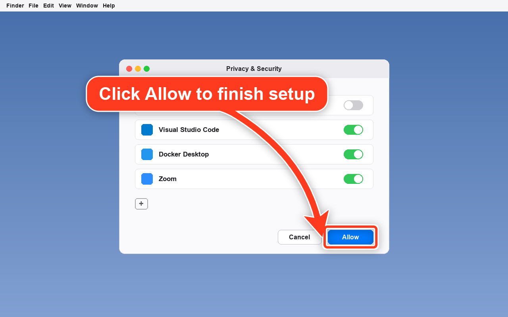
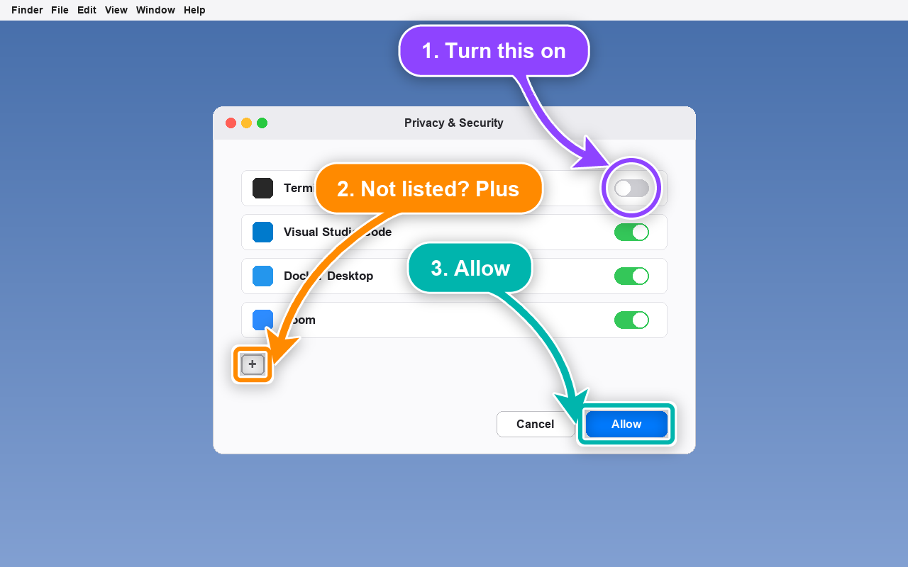
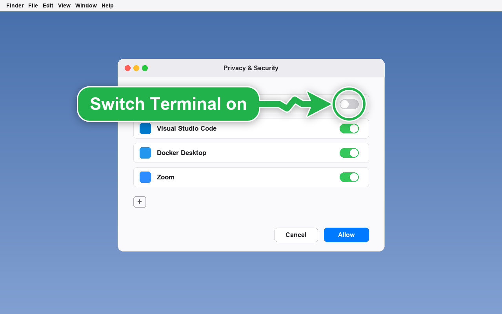
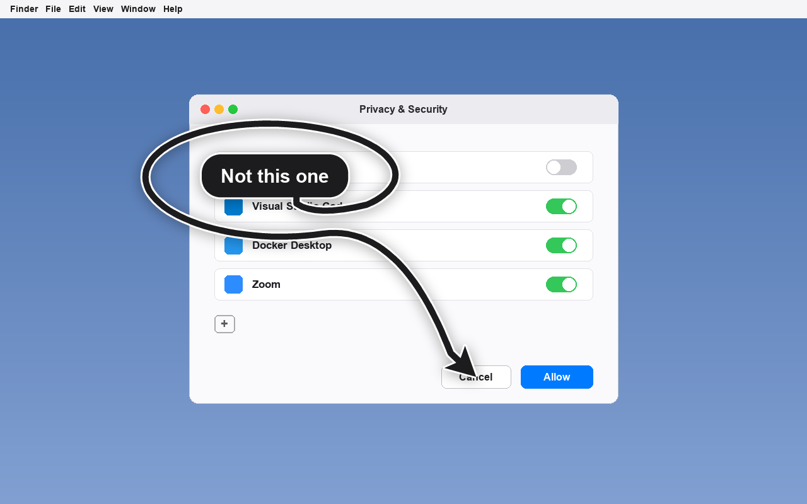
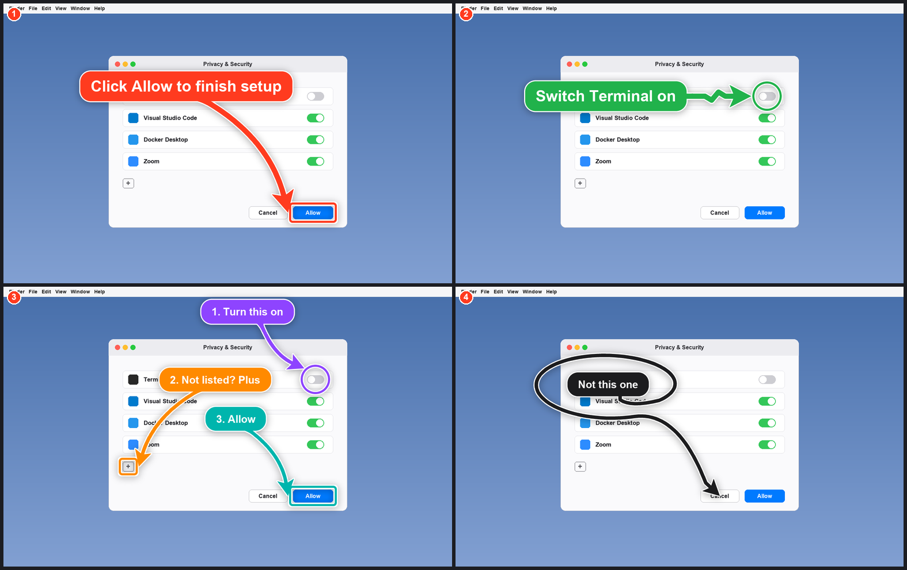
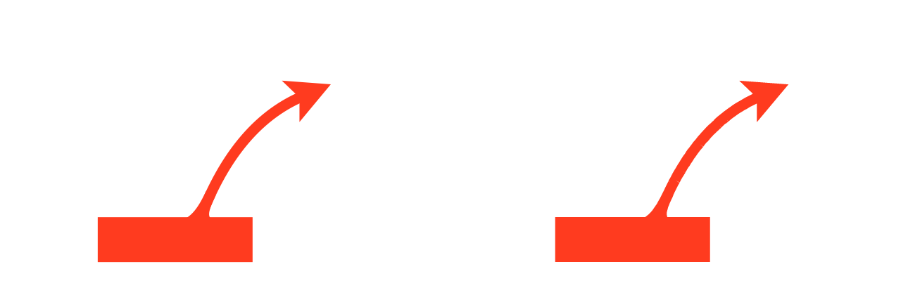

<div align="center">

# arrowshot

**Point at anything in a screenshot with a big arrow, ring or box and a sign. Any OS, one Python file.**

[big-arrow-on-the-screen](https://github.com/franzenzenhofer/big-arrow-on-the-screen) gave macOS agents a finger to point with. arrowshot brings the same arrows to Windows and Linux screenshots, and adds [scrawl](https://github.com/kitlangton/scrawl)'s contact sheet so many shots read as one image.

Works with **Claude Code** and **Codex**.

 



<sub>Real output of <code>python arrowshot.py demo</code>. The dialog is a demo screen drawn by the script itself.</sub>

</div>

## Quick start
```bash
git clone https://github.com/Dodai0419/arrowshot && cd arrowshot && pip install pillow
python arrowshot.py point docs/screen.png --rect 826,580,114,36 --text "Click Allow to finish setup" -o allow.png
```
```
allow.png: arrow from top-left to (812,598), sign at (219,194)
```
`--rect x,y,w,h` boxes an element and the arrow stops just outside the box. `--at x,y` hits a point exactly.

## Gallery
Each image is the unedited output of `python arrowshot.py demo --out docs`.

**A how-to in one picture: three marks, three colours, signs that keep out of each other's way**



```bash
python arrowshot.py point docs/screen.png --marks steps.json -o steps.png
```
```json
[{"rect": [866, 253, 48, 24], "text": "1. Turn this on", "style": "ring", "color": "purple", "size": "S", "from": "top-left"},
 {"rect": [340, 500, 32, 28], "text": "2. Not listed? Plus", "style": "box", "color": "orange", "size": "S", "from": "bottom-left"},
 {"rect": [826, 580, 114, 36], "text": "3. Allow", "color": "teal", "size": "S", "from": "bottom-left"}]
```

**Ring plus zigzag: hard to miss**



```bash
python arrowshot.py point docs/screen.png --rect 866,253,48,24 --style ring --shape zigzag --color green --text "Switch Terminal on"
```

**Spiral: "not this one"**



```bash
python arrowshot.py point docs/screen.png --at 755,598 --shape spiral --color black --size S --text "Not this one"
```

**Many shots, one image: scrawl's contact sheet**



```bash
python arrowshot.py sheet allow.png toggle.png steps.png spiral.png -o sheet.png
```

Rows are justified so every shot gets about the same area, and the whole sheet stays near the aspect ratio vision models read best, exactly as scrawl lays it out (up to 12 shots, at most 1600 px on the long edge).

## What you can set
| Flag | Values | Default |
|---|---|---|
| `--at x,y` / `--rect x,y,w,h` | target point, or element to box | one is required |
| `--text` | the sign; wraps to 3 lines, shrinks to fit | empty |
| `--from` | `auto`, `top`, `bottom`, `left`, `right`, `top-left`, `top-right`, `bottom-left`, `bottom-right` | `auto` (most free space) |
| `--style` | `arrow`, `ring`, `box` | `arrow` |
| `--shape` | `bend`, `straight`, `zigzag`, `spiral` | `bend` |
| `--color` | `red`, `orange`, `yellow`, `green`, `teal`, `blue`, `purple`, `pink`, `black`, `white`, `#RRGGBB` | `red` |
| `--size` | `S`, `M`, `L` | `M` |
| `--corners` | `round`, `sharp` | `round` |
| `--marks file.json` | a list of marks with the same keys | |
| `--json` | print each tip and sign position | |

`--from` is a preference, as in bigarrow: if the sign does not fit on that side, the roomiest other side wins, because an arrow must never hide what it points at.

## The problem
- bigarrow draws great arrows, but only on a live macOS screen (Swift + AppKit). Windows and Linux users, CI screenshots and docs get nothing.
- An agent that wants to show *where* has to write "the toggle on the right of the third row" and hope.
- Several screenshots pasted one by one get read one by one, or not at all.

## The solution
| Idea | Fixes |
|------|-------|
| **bigarrow's geometry, ported 1:1** | Same sign placement, flared root, bend/zigzag/spiral shafts, notched head, ring and box marks. Checked against bigarrow's own golden PNG and its geometry tests |
| **Draw on the image, not the screen** | Works on any OS and on any PNG: bug reports, docs, CI screenshots, review comments |
| **scrawl's contact sheet** | Up to 12 shots in one balanced, numbered image an agent or a human reads in one look |

## Use with Claude Code
```bash
/plugin marketplace add Dodai0419/arrowshot
/plugin install arrowshot@arrowshot
```
Then ask: *"Take a screenshot of the settings page and point at the button I should click."*

## Use with Codex (ChatGPT)
```bash
git clone https://github.com/Dodai0419/arrowshot && cp -r arrowshot/skills/* ~/.codex/skills/
```
Or copy `AGENTS.md` into your project root.

## Same arrows as bigarrow (checked)
bigarrow has a golden snapshot test: one red arrow on a 640x400 canvas, rendered with CoreGraphics, and a rule that at most 0.5% of pixels may differ by more than 24 per channel. `tests/test_arrowshot.py` renders the same scene with arrowshot and applies the same rule.



<sub>Left: bigarrow's committed golden PNG. Right: arrowshot. 0.263% of pixels differ by more than 24 (limit 0.5%), all on anti-aliased edges. Changing the bow of the curve from 0.22 to 0.30 of its length makes 2.07% differ, so the check does catch geometry changes.</sub>

The tests also port bigarrow's geometry assertions: the tip hits the target within 0.5 px from all 8 sides, the head follows the shaft's last tangent, shaft/head/sign stay on screen, rect targets get a box with the tip just outside the facing edge, every shape (bend, straight, zigzag, spiral) hits the target, a zigzag leaves the sign straight and runs straight into the head.

The contact-sheet layout was compared with scrawl's own Rust code (`plan_contact_sheet_rows` and the cell maths, compiled unchanged): **5,000 random sets of 1-12 screenshot sizes, 5,000 identical** cell rectangles and sheet sizes. 80 of them are in `tests/upstream_sheet.json`.

## Benchmarks
| | bigarrow + scrawl | arrowshot |
|-|-|-|
| runs on | bigarrow: macOS only (Swift, AppKit). scrawl: Apple silicon macOS, Windows preview | anything with Python 3.9+ and Pillow |
| code for these features (non-blank lines) | 1,008 (bigarrow geometry) + 309 (bigarrow overlay drawing) + 267 (scrawl sheet) = **1,584** | **581**, including CLI and demo screen |
| whole project (non-blank lines) | 4,595 Swift + 66,601 Rust | 581 Python |
| dependencies | Swift toolchain + AppKit; scrawl: 11 crates incl. GPUI | Pillow |
| one mark on a 1280x800 PNG | not measured: bigarrow draws on a live macOS screen, not on files | **228 ms** median of 10 (in process) |
| whole `point` command, cold start | not measured | 718-896 ms (3 runs) |
| plan a 12-shot sheet | not measured in scrawl itself | 6.9 ms median of 20 |

Windows 11, Python 3.11, Pillow 12.3. Reproduce the arrowshot numbers with `python -m unittest -q` and the commands above; line counts are `grep -vc '^\s*$'` over the listed files (bigarrow commit 8917602: ArrowGeometry, ArrowRoot, ArrowShaft, Placement, SignJunction, Spiral, OverlayLayout, Vector, ArrowAppearance, SignAppearance, Display, Target; OverlayLayers + SignRenderer. scrawl commit 6c151a0: the two functions in `src/render.rs`).

## Honest limits
- arrowshot does not find elements for you. bigarrow can resolve `--element "Allow"` through macOS accessibility; here you pass coordinates (an agent with vision can read them off the screenshot).
- No live overlay, no auto-dismiss, no copy buttons in signs: it draws on images.
- The sign text uses Arial Bold, DejaVu Sans Bold or Liberation Sans Bold if one is installed, else Pillow's built-in font, so letters look a little different per OS.

## Inspired by
- [franzenzenhofer/big-arrow-on-the-screen](https://github.com/franzenzenhofer/big-arrow-on-the-screen): the arrow, sign placement, shapes, styles and colours, ported from its `BigArrowCore`
- [kitlangton/scrawl](https://github.com/kitlangton/scrawl): the contact-sheet layout that packs annotated frames into one image for an agent

## Roadmap
- [ ] `--find "Allow"`: locate the target by text (OCR) instead of coordinates
- [ ] Animated GIF output: the arrow grows in, like bigarrow's overlay
- [ ] `--blur x,y,w,h`: hide secrets in the same pass

## License
MIT. Arrow geometry ported from big-arrow-on-the-screen (MIT, Franz Enzenhofer); contact-sheet layout ported from scrawl (MIT, Kit Langton). See `LICENSE` and `NOTICE`.
